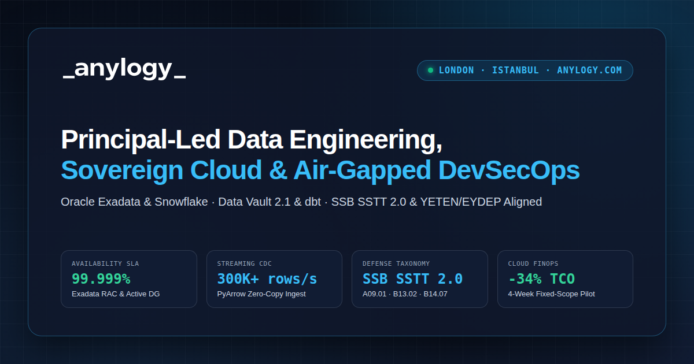

  

# Anylogy (`anylogy.com`)

**Principal-Led Data Engineering, Sovereign AI & On-Premise Blackwell/Hopper LLM Inference, Oracle Exadata Rescue, and Air-Gapped DevSecOps for Mission-Critical Enterprises.**

Anylogy (**ANYLOGY YAZILIM LTD. ŞTİ.**, İTO `460178-5` · MERSİS `0070111020100001`, Est. 2023 in Istanbul; backed by UK consulting heritage **Periscube Ltd.**, London, Est. 2011) provides Direct Access to our Principal Architects and Engineers across **Defense & Aerospace**, **BDDK-Regulated Banking & FinTech**, **Global Retail & Industrial Holdings**, and **Mobility**.
Every engagement executes inside sovereign on-premise data centers or accredited private clouds with zero external telemetry leakage and full alignment with **SSB SSTT 2.0**, **Cybersecurity Law No. 7545**, **KVKK 6698/7499**, **BDDK Private Cloud**, and **Presidential Circular 2026/9**.

---

## Defense & Regulated Enterprise Capabilities Matrix (SSB SSTT 2.0 Aligned)

| SSTT 2.0 / Domain Code | Practice Area | Core Engineering Stack & Sovereign Capabilities |
| :--- | :--- | :--- |
| **A09.01** | **Data & Information Management** (`Veri ve Bilgi Yönetimi`) | High-availability enterprise data warehousing (`Oracle Exadata 19c/23ai RAC`, `Snowflake`, `DuckDB`, `Polars`), `TOGAF 9.1`, `Data Vault 2.1`, `TM Forum SID (GB922)`, and high-throughput ELT/ETL (`ODI 12c`, `dbt Core/Cloud`, `Apache Airflow`). |
| **B13.02** | **Big Data & Real-Time Streaming** (`Büyük Veri Analitiği`) | `300,000+ rows/sec` zero-copy `PyArrow` C++ streaming ingestion (`<80 MB RSS`), executive decision cockpits (`ADF Decision Studio`, `OAS`, `Power BI`), and governed `FastMCP` semantic layers. |
| **Sovereign AI & LLM** | **On-Premise LLM Inference & Token Economics** (`Egemen Yapay Zeka`) | Self-hosted open-weight LLM clusters on dedicated `NVIDIA Blackwell B200` and `Hopper` GPUs (`NVFP4 / FP8` quantization, `~35%` lower GPU memory, `>85%` KV prefix cache, `78%` faster TTFT), `tokener` budget circuit breakers, and `8MW-to-64MW` Direct-Liquid-Cooled `InfraCo / PlatCo` blueprints. |
| **B14.07 & B14.12** | **Air-Gapped DevSecOps & Container Security** | Disconnected CI/CD pipelines, automated SAST/DAST/SBOM gates, CIS-hardened `HashiCorp Packer` Golden AMIs, `Harbor` & hermetic offline `uv` wheel registries, `Terraform` IaC, and hardened `Kubernetes / OpenShift`. |
| **B13.01 & A08.04** | **Sovereign Private Cloud & DB Rescue** | Zero-telemetry private cloud control planes, `CPU/GPU Confidential Computing (TEEs, HSM)`, active-active fault tolerance, and 10-node `Exadata DBRM v5` / monolithic `MS SQL Server` offloading rescues. |
| **B14.05, B09.10 & C07.20** | **Cryptographic Privacy & IIoT Telemetry** | `KVKKVault` (`AES-256-GCM / HKDF`) PII tokenization airlocks, `Oracle VPD` / `Snowflake RLS` row-level security, immutable audit trails, and `50M+ files/day` industrial / rail / avionics sensor telemetry. |

---

## Audited Production Benchmarks

- **78% Faster On-Premise LLM TTFT & Order-of-Magnitude Token Cost Compression:** Slashed Time-to-First-Token from `>15s to 3.3s` under a `50%+` concurrency surge on dedicated `NVIDIA Blackwell B200` and `Hopper` GPUs with zero offshore data retention.
- **99.999% Availability & +40% Exadata Headroom:** Eliminated `99.9%` of `resmgr:cpu quantum` waits, uncaged `512` parallel hardware threads, and cut nightly batch overruns by `5.0 hours/day` across a 10-node `Oracle Exadata 19c RAC` cluster (`50M+` subscriber scale) with zero new hardware CapEx.
- **100% Production Crash Elimination via Monolith Offloading:** Refactored `15,000+` lines of complex `T-SQL` stored procedures on a 256-core, `1 TB RAM` `MS SQL Server` into modular `dbt`, `DuckDB`, and `Polars` models, eliminating recurring twice-monthly outages.
- **300,000+ Rows/Sec Zero-Copy Streaming (76% Faster Daily Load):** Compressed daily `20 TB` compressed file ingestion (`200,000` files/day, `>20.5B` records) from `14.5 hours to 3.5 hours` using `1/10th` the CPU, RAM, and storage footprint.
- **6 Weeks to 6 Minutes Release Velocity (>1,000x Speedup) & Licensing FinOps:** Pre-accredited `Packer` Golden AMIs across a `GBP 1.6B` rail IoT program; uncovered `~22%` orphaned cloud spend during a `$5B` M&A transition and saved over `£1,000,000/yr` in `Oracle` licensing via hard-isolated cluster design.

---

## Sovereign Engagement Value Ladder (USD Global / TRY Domestic e-Fatura)

All engagements operate on fixed deliverables, 100% client IP ownership, and domestic Turkish e-Fatura (`0%` foreign consulting withholding tax for Turkish enterprises) or international USD invoicing:

1. **Tier 1 - Free 15-Point Executive Waste & Sovereign LLM Scorecard (`$0` / `0 TL`):** Read-only diagnostic SQL pack and 4-page A4 Executive PDF Scorecard - [EN](https://anylogy.com/offers/exadata-finops-auditor/) | [TR](https://anylogy.com/tr/offers/exadata-finops-auditor/)
2. **Tier 2 - 5-Day Read-Only Forensic Diagnostic (`$7,500` / `300.000 TL`):** Single-signature / *Doğrudan Temin* root-cause audit and board-ready remediation blueprint backed by a **5x Verified Annual Savings Guarantee** (`100%` credited to Tier 3) - [EN](https://anylogy.com/offers/5-day-exadata-diagnostic/) | [TR](https://anylogy.com/tr/offers/5-day-exadata-diagnostic/)
3. **Tier 3 - 28-Day Fixed-Scope Production Sprint (`$30,000` / `1.200.000 TL`):** Bounded 4-week on-premise or sovereign VPC delivery across `Exadata DBRM`, `Data Vault 2.1 / dbt`, `Blackwell/Hopper LLM Inference`, or `Air-Gapped DevSecOps` - [EN](https://anylogy.com/offers/4-week-pilot-sprint/) | [TR](https://anylogy.com/tr/offers/4-week-pilot-sprint/)
4. **Tier 4 - Principal Design Authority & Automated Governance Retainer (`$9,000/mo` / `360.000 TL/ay`):** Automated CI/CD schema & token gates (`3nf-db-auditor`, `tokener`), `48h` async ADR sign-off, and monthly CFO/CIO FinOps telemetry (capped at 3 active clients) - [EN](https://anylogy.com/offers/principal-retainer/) | [TR](https://anylogy.com/tr/offers/principal-retainer/)
5. **Strategic Enterprise & Consortium Blueprints (`From $45,000` / `1.800.000 TL+`):** `8MW-64MW` Sovereign AI Data Center blueprints, SSB prime subcontractor packages, and M&A technical due diligence - [Pricing](https://anylogy.com/pricing/) | [Ücretlendirme](https://anylogy.com/tr/pricing/)

---

## Connect With Our Principal Architects

- **Website (English):** [https://anylogy.com](https://anylogy.com)
- **Website (Türkçe - Kurumsal & Savunma):** [https://anylogy.com/tr/](https://anylogy.com/tr/)
- **SSB SSTT 2.0 Yetkinlik Matrisi:** [https://anylogy.com/sstt/](https://anylogy.com/sstt/)
- **Kurumsal Künye, İTO/MERSİS & BGYS Politikaları:** [https://anylogy.com/kurumsal/](https://anylogy.com/kurumsal/)
- **AI & LLM Technical Dossier (`llms.txt`):** [https://anylogy.com/llms.txt](https://anylogy.com/llms.txt)
- **Sovereign First-Party Intake:** [https://anylogy.com/contact/](https://anylogy.com/contact/) | [https://anylogy.com/tr/contact/](https://anylogy.com/tr/contact/)
- **LinkedIn:** [https://www.linkedin.com/company/anylogy](https://www.linkedin.com/company/anylogy)
- **Email:** [hello@anylogy.com](mailto:hello@anylogy.com)
